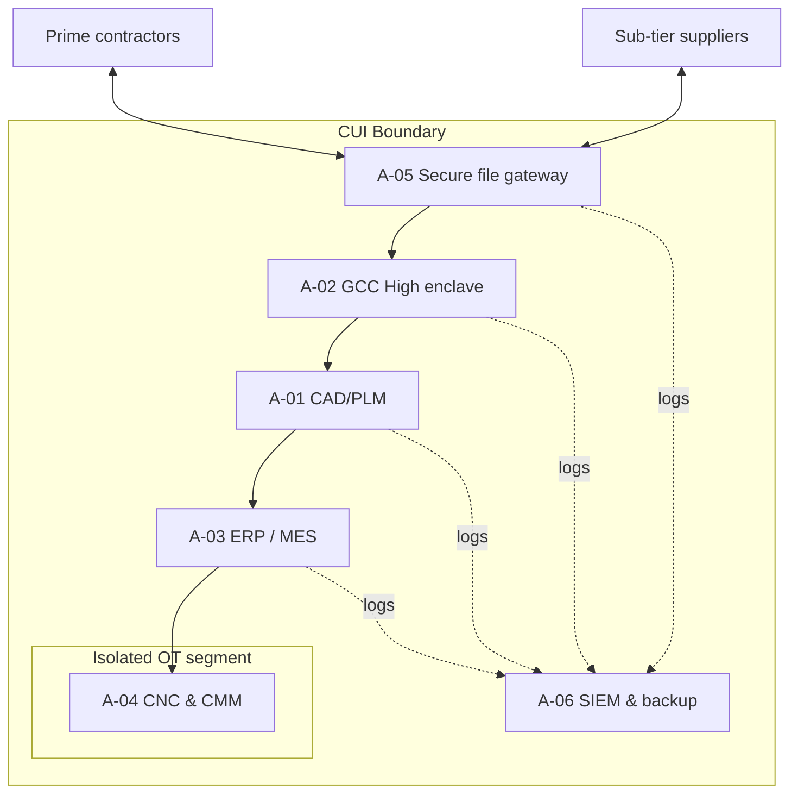

[Overview](README.md) · **Asset Inventory** · [CUI Data Flows](CUI-Data-Flows.md) · [CMMC Controls](CMMC-Controls.md) · [Supply Chain](Supply-Chain-Vendor-Assessment.md) · [Evidence](Evidence-Register.md) · [SSP & C3PAO Readiness](SSP-and-C3PAO-Readiness.md)

---

# Asset Inventory & CMMC Scoping
**GlobalParts Manufacturing** · Document ID: GP-CMMC-AST-001 · Version 1.0 · Classification: Internal (portfolio sample — contains no real CUI)

## Purpose
Defines what is in scope for the CMMC Level 2 assessment. Each asset is categorised using the CMMC Level 2 Scoping Guidance. Correct categorisation decides which NIST SP 800-171 requirements apply and what the C3PAO will test.

## Summary

| ID | Name | Type | Classification | Owner | Environment | CMMC Asset Category |
|---|---|---|---|---|---|---|
| [A-01](#a-01) | CAD/PLM Engineering Workstations & Server | Application | 🔴 Critical | Director of Engineering | Production | CUI Asset |
| [A-02](#a-02) | CUI Enclave — Microsoft 365 GCC High Tenant | Cloud Account | 🔴 Critical | IT Manager | Production | CUI Asset |
| [A-03](#a-03) | ERP / MES Production System | Database | 🟠 High | Plant Systems Manager | Production | CUI Asset |
| [A-04](#a-04) | CNC Machining Centres & CMM Inspection Systems | Endpoint | 🟠 High | Plant Operations Manager (Ohio) | Production | Specialized Asset (OT) |
| [A-05](#a-05) | Secure File Transfer Gateway | Network Device | 🔴 Critical | IT Security Lead | Production | Security Protection Asset |
| [A-06](#a-06) | SIEM & Backup Platform | Server | 🟠 High | IT Security Lead | DR | Security Protection Asset |

## Scope by CMMC Asset Category

| Category | Count | Assessment treatment |
|---|---|---|
| CUI Asset | 3 | Assessed against all applicable 800-171 requirements |
| Specialized Asset (OT) | 1 | Documented in the SSP and asset inventory and shown in the network diagram; not assessed against all requirements, but must be protected by risk-based controls such as segmentation |
| Security Protection Asset | 2 | Assessed against the requirements relevant to the security functions they provide |

## Asset Details

### A-01
**CAD/PLM Engineering Workstations & Server**

| Field | Value |
|---|---|
| Type | Application |
| Classification | 🔴 Critical |
| Owner | Director of Engineering |
| Environment | Production |
| CMMC asset category | CUI Asset |
| Data flows | [DPA-01](CUI-Data-Flows.md#dpa-01), [DPA-02](CUI-Data-Flows.md#dpa-02) |
| Controls | [CC-01](CMMC-Controls.md#cc-01), [CC-02](CMMC-Controls.md#cc-02), [CC-04](CMMC-Controls.md#cc-04), [CC-05](CMMC-Controls.md#cc-05), [CC-06](CMMC-Controls.md#cc-06), [CC-07](CMMC-Controls.md#cc-07), [CC-09](CMMC-Controls.md#cc-09), [CC-11](CMMC-Controls.md#cc-11), [CC-12](CMMC-Controls.md#cc-12), [CC-14](CMMC-Controls.md#cc-14) |

Siemens NX CAD and Teamcenter PLM holding defence customers' technical drawings, 3D models and specifications (CUI//SP-CTI). Used by 85 engineers in Detroit. Primary CUI repository; must enforce 800-171 access control (3.1), audit logging (3.3) and FIPS-validated encryption at rest (3.13.16).

### A-02
**CUI Enclave — Microsoft 365 GCC High Tenant**

| Field | Value |
|---|---|
| Type | Cloud Account |
| Classification | 🔴 Critical |
| Owner | IT Manager |
| Environment | Production |
| CMMC asset category | CUI Asset |
| Data flows | [DPA-01](CUI-Data-Flows.md#dpa-01), [DPA-02](CUI-Data-Flows.md#dpa-02), [DPA-04](CUI-Data-Flows.md#dpa-04), [DPA-05](CUI-Data-Flows.md#dpa-05), [DPA-06](CUI-Data-Flows.md#dpa-06) |
| Controls | [CC-01](CMMC-Controls.md#cc-01), [CC-02](CMMC-Controls.md#cc-02), [CC-03](CMMC-Controls.md#cc-03), [CC-06](CMMC-Controls.md#cc-06), [CC-07](CMMC-Controls.md#cc-07), [CC-10](CMMC-Controls.md#cc-10), [CC-11](CMMC-Controls.md#cc-11), [CC-12](CMMC-Controls.md#cc-12), [CC-14](CMMC-Controls.md#cc-14) |

Dedicated GCC High tenant for email, SharePoint and Teams handling CUI. Isolates CUI from the commercial M365 tenant used by the rest of the business, reducing CMMC assessment scope. FedRAMP High equivalent, meeting DFARS 252.204-7012 cloud requirements.

### A-03
**ERP / MES Production System**

| Field | Value |
|---|---|
| Type | Database |
| Classification | 🟠 High |
| Owner | Plant Systems Manager |
| Environment | Production |
| CMMC asset category | CUI Asset |
| Data flows | [DPA-03](CUI-Data-Flows.md#dpa-03), [DPA-05](CUI-Data-Flows.md#dpa-05) |
| Controls | [CC-02](CMMC-Controls.md#cc-02), [CC-04](CMMC-Controls.md#cc-04), [CC-06](CMMC-Controls.md#cc-06), [CC-07](CMMC-Controls.md#cc-07), [CC-08](CMMC-Controls.md#cc-08), [CC-09](CMMC-Controls.md#cc-09), [CC-11](CMMC-Controls.md#cc-11), [CC-12](CMMC-Controls.md#cc-12), [CC-14](CMMC-Controls.md#cc-14) |

SQL-based ERP/MES storing work orders, part numbers, routing sheets and inspection data tied to CUI drawings. Shared across Michigan and Ohio plants. Currently accessible from the corporate network, which pulls it into CMMC scope.

### A-04
**CNC Machining Centres & CMM Inspection Systems**

| Field | Value |
|---|---|
| Type | Endpoint |
| Classification | 🟠 High |
| Owner | Plant Operations Manager (Ohio) |
| Environment | Production |
| CMMC asset category | Specialized Asset (OT) |
| Data flows | [DPA-03](CUI-Data-Flows.md#dpa-03) |
| Controls | [CC-04](CMMC-Controls.md#cc-04), [CC-05](CMMC-Controls.md#cc-05), [CC-07](CMMC-Controls.md#cc-07), [CC-08](CMMC-Controls.md#cc-08), [CC-14](CMMC-Controls.md#cc-14) |

42 CNC machines and 6 coordinate-measuring machines that load CUI part programs. Legacy Windows 7 controllers cannot be patched or run EDR. Must be documented in the SSP and protected by segmentation rather than host controls.

### A-05
**Secure File Transfer Gateway**

| Field | Value |
|---|---|
| Type | Network Device |
| Classification | 🔴 Critical |
| Owner | IT Security Lead |
| Environment | Production |
| CMMC asset category | Security Protection Asset |
| Data flows | [DPA-01](CUI-Data-Flows.md#dpa-01), [DPA-04](CUI-Data-Flows.md#dpa-04), [DPA-05](CUI-Data-Flows.md#dpa-05) |
| Controls | [CC-02](CMMC-Controls.md#cc-02), [CC-03](CMMC-Controls.md#cc-03), [CC-06](CMMC-Controls.md#cc-06), [CC-07](CMMC-Controls.md#cc-07), [CC-09](CMMC-Controls.md#cc-09), [CC-11](CMMC-Controls.md#cc-11), [CC-13](CMMC-Controls.md#cc-13), [CC-14](CMMC-Controls.md#cc-14) |

Managed SFTP/MFT gateway used to exchange drawings with prime contractors and 14 sub-tier suppliers (heat-treat, plating, coating). Enforces MFA, encryption in transit (3.13.8) and transfer logging. Replaces ad hoc email and USB transfers.

### A-06
**SIEM & Backup Platform**

| Field | Value |
|---|---|
| Type | Server |
| Classification | 🟠 High |
| Owner | IT Security Lead |
| Environment | DR |
| CMMC asset category | Security Protection Asset |
| Data flows | [DPA-06](CUI-Data-Flows.md#dpa-06) |
| Controls | [CC-06](CMMC-Controls.md#cc-06), [CC-07](CMMC-Controls.md#cc-07), [CC-10](CMMC-Controls.md#cc-10), [CC-11](CMMC-Controls.md#cc-11), [CC-14](CMMC-Controls.md#cc-14) |

Centralised log collection (3.3.x) and immutable backups for CUI systems, replicated to the Ohio DR site. Security Protection Assets are assessed against the same 800-171 requirements as CUI assets.

---

← Previous: [Overview](README.md) · [↑ Overview](README.md) · **Next: [CUI Data Flows](CUI-Data-Flows.md) →**
