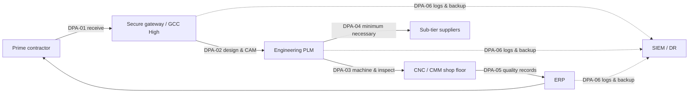

[Overview](README.md) · [Asset Inventory](Asset-Inventory.md) · **CUI Data Flows** · [CMMC Controls](CMMC-Controls.md) · [Supply Chain](Supply-Chain-Vendor-Assessment.md) · [Evidence](Evidence-Register.md) · [SSP & C3PAO Readiness](SSP-and-C3PAO-Readiness.md)

---

# CUI Data Flows (Data Processing Activities)
**GlobalParts Manufacturing** · Document ID: GP-CMMC-DPA-001 · Version 1.0 · Classification: Internal (portfolio sample — contains no real CUI)

## Purpose
Traces Controlled Unclassified Information through its lifecycle at GlobalParts, from receipt from prime contractors to sharing with sub-tier suppliers and delivery of quality records. These flows define the CUI boundary described in the System Security Plan and support the CUI handling and marking task.

## Summary

| ID | Activity | CUI Category | Source → Recipient | Assets | Owner | Retention |
|---|---|---|---|---|---|---|
| [DPA-01](#dpa-01) | Receive CUI drawings and specifications from prime contractors | CUI//SP-CTI (Controlled Technical Information); some CUI//SP-EXPT (export-controlled) | Prime contractor portals; DoD SAFE | [A-05](Asset-Inventory.md#a-05), [A-02](Asset-Inventory.md#a-02), [A-01](Asset-Inventory.md#a-01) | Contracts & Engineering Liaison | Life of contract + 3 years |
| [DPA-02](#dpa-02) | Engineering design, CAM programming and configuration control | CUI//SP-CTI | Internal engineering team | [A-01](Asset-Inventory.md#a-01), [A-02](Asset-Inventory.md#a-02) | Director of Engineering | Life of part + 10 years (AS9100 records) |
| [DPA-03](#dpa-03) | CNC machining and dimensional inspection on the shop floor | CUI//SP-CTI (part programs, inspection plans) | Engineering → plant floor | [A-03](Asset-Inventory.md#a-03), [A-04](Asset-Inventory.md#a-04) | Plant Operations Manager (Ohio) | Programs: life of part · Inspection reports: 10 years |
| [DPA-04](#dpa-04) | Share CUI with sub-tier suppliers for outside processing | CUI//SP-CTI (flow-down of minimum necessary drawings) | GlobalParts → 14 sub-tier suppliers | [A-05](Asset-Inventory.md#a-05), [A-02](Asset-Inventory.md#a-02) | Supply Chain Security Manager | Transfer logs: 3 years |
| [DPA-05](#dpa-05) | Quality records, certificates of conformance and shipping documentation | CUI//SP-CTI (inspection data referencing controlled specs); CUI//SP-EXPT on some shipments | Quality → prime contractors | [A-03](Asset-Inventory.md#a-03), [A-02](Asset-Inventory.md#a-02), [A-05](Asset-Inventory.md#a-05) | Quality Director | 10 years (contract and AS9100 requirement) |
| [DPA-06](#dpa-06) | Security monitoring, backup and incident reporting for CUI systems | Security logs and backups containing CUI | CUI enclave, OT network → SIEM / DR site | [A-06](Asset-Inventory.md#a-06), [A-02](Asset-Inventory.md#a-02) | IT Security Lead | Logs: 1 year online + 90-day image preservation per DFARS 7012 |

## Activity Details

### DPA-01
**Receive CUI drawings and specifications from prime contractors**

| Field | Value |
|---|---|
| CUI / data category | CUI//SP-CTI (Controlled Technical Information); some CUI//SP-EXPT (export-controlled) |
| Source → recipient | Prime contractor portals; DoD SAFE |
| Assets involved | [A-05](Asset-Inventory.md#a-05), [A-02](Asset-Inventory.md#a-02), [A-01](Asset-Inventory.md#a-01) |
| Owner | Contracts & Engineering Liaison |
| Location | Detroit HQ |
| Key NIST SP 800-171 requirements | 3.1.1, 3.1.3, 3.8.1, 3.13.8 |
| Retention | Life of contract + 3 years |
| Controls | [CC-01](CMMC-Controls.md#cc-01), [CC-02](CMMC-Controls.md#cc-02), [CC-03](CMMC-Controls.md#cc-03), [CC-14](CMMC-Controls.md#cc-14) |

Primes release drawing packages under DFARS 252.204-7012. Files arrive through the secure file transfer gateway or DoD SAFE, are logged, checked for CUI markings, and stored in the GCC High SharePoint CUI library before release into PLM.

### DPA-02
**Engineering design, CAM programming and configuration control**

| Field | Value |
|---|---|
| CUI / data category | CUI//SP-CTI |
| Source → recipient | Internal engineering team |
| Assets involved | [A-01](Asset-Inventory.md#a-01), [A-02](Asset-Inventory.md#a-02) |
| Owner | Director of Engineering |
| Location | Detroit HQ |
| Key NIST SP 800-171 requirements | 3.1.1, 3.1.2, 3.3.1, 3.4.1, 3.13.16 |
| Retention | Life of part + 10 years (AS9100 records) |
| Controls | [CC-01](CMMC-Controls.md#cc-01), [CC-04](CMMC-Controls.md#cc-04), [CC-07](CMMC-Controls.md#cc-07), [CC-09](CMMC-Controls.md#cc-09), [CC-11](CMMC-Controls.md#cc-11), [CC-12](CMMC-Controls.md#cc-12), [CC-14](CMMC-Controls.md#cc-14) |

Engineers derive manufacturing models and CNC programs from customer drawings. Derivative files inherit the source CUI marking. Access is role-based by programme, and all check-out and check-in events are logged in PLM.

### DPA-03
**CNC machining and dimensional inspection on the shop floor**

| Field | Value |
|---|---|
| CUI / data category | CUI//SP-CTI (part programs, inspection plans) |
| Source → recipient | Engineering → plant floor |
| Assets involved | [A-03](Asset-Inventory.md#a-03), [A-04](Asset-Inventory.md#a-04) |
| Owner | Plant Operations Manager (Ohio) |
| Location | Michigan & Ohio plants |
| Key NIST SP 800-171 requirements | 3.1.20, 3.8.7, 3.13.1, 3.13.6 |
| Retention | Programs: life of part · Inspection reports: 10 years |
| Controls | [CC-04](CMMC-Controls.md#cc-04), [CC-05](CMMC-Controls.md#cc-05), [CC-07](CMMC-Controls.md#cc-07), [CC-08](CMMC-Controls.md#cc-08), [CC-14](CMMC-Controls.md#cc-14) |

Part programs are pushed from MES to CNC controllers over an isolated OT VLAN, with no internet or email access. USB use is blocked except for one controlled media station. Printed drawings at machines carry CUI cover sheets and are shredded at job close.

### DPA-04
**Share CUI with sub-tier suppliers for outside processing**

| Field | Value |
|---|---|
| CUI / data category | CUI//SP-CTI (flow-down of minimum necessary drawings) |
| Source → recipient | GlobalParts → 14 sub-tier suppliers |
| Assets involved | [A-05](Asset-Inventory.md#a-05), [A-02](Asset-Inventory.md#a-02) |
| Owner | Supply Chain Security Manager |
| Location | Detroit HQ (procurement) |
| Key NIST SP 800-171 requirements | 3.1.3, 3.1.22, 3.13.8, 3.14.x (via flow-down) |
| Retention | Transfer logs: 3 years |
| Controls | [CC-02](CMMC-Controls.md#cc-02), [CC-03](CMMC-Controls.md#cc-03), [CC-09](CMMC-Controls.md#cc-09), [CC-13](CMMC-Controls.md#cc-13), [CC-14](CMMC-Controls.md#cc-14) |

Only drawings required for the operation (e.g., heat-treat or plating spec) are shared. Suppliers receive them through the secure gateway with time-limited access. DFARS 7012 and CMMC Level 2 requirements are flowed down in purchase orders, and supplier SPRS scores are verified before CUI release.

### DPA-05
**Quality records, certificates of conformance and shipping documentation**

| Field | Value |
|---|---|
| CUI / data category | CUI//SP-CTI (inspection data referencing controlled specs); CUI//SP-EXPT on some shipments |
| Source → recipient | Quality → prime contractors |
| Assets involved | [A-03](Asset-Inventory.md#a-03), [A-02](Asset-Inventory.md#a-02), [A-05](Asset-Inventory.md#a-05) |
| Owner | Quality Director |
| Location | Michigan & Ohio plants |
| Key NIST SP 800-171 requirements | 3.1.1, 3.3.1, 3.8.4, 3.8.9 |
| Retention | 10 years (contract and AS9100 requirement) |
| Controls | [CC-04](CMMC-Controls.md#cc-04), [CC-09](CMMC-Controls.md#cc-09), [CC-11](CMMC-Controls.md#cc-11), [CC-14](CMMC-Controls.md#cc-14) |

First-article inspection reports, CoCs and material certs are generated in ERP, marked, and delivered to primes through their portals. Records are backed up to immutable storage at the DR site and protected with FIPS-validated encryption.

### DPA-06
**Security monitoring, backup and incident reporting for CUI systems**

| Field | Value |
|---|---|
| CUI / data category | Security logs and backups containing CUI |
| Source → recipient | CUI enclave, OT network → SIEM / DR site |
| Assets involved | [A-06](Asset-Inventory.md#a-06), [A-02](Asset-Inventory.md#a-02) |
| Owner | IT Security Lead |
| Location | Ohio DR site + cloud SIEM |
| Key NIST SP 800-171 requirements | 3.3.1, 3.3.5, 3.6.1, 3.6.2, 3.8.9 |
| Retention | Logs: 1 year online + 90-day image preservation per DFARS 7012 |
| Controls | [CC-06](CMMC-Controls.md#cc-06), [CC-10](CMMC-Controls.md#cc-10), [CC-14](CMMC-Controls.md#cc-14) |

Logs from CUI and Security Protection Assets are centralised and reviewed weekly. Cyber incidents affecting CUI are reported to DoD via the DIBNet portal within 72 hours, with forensic images preserved for 90 days as required by DFARS 252.204-7012.

> CUI categories follow the DoD CUI Registry. Requirement numbers refer to NIST SP 800-171 Rev 2, the revision used for CMMC Level 2 assessments.

---

← Previous: [Asset Inventory](Asset-Inventory.md) · [↑ Overview](README.md) · **Next: [CMMC Controls](CMMC-Controls.md) →**
