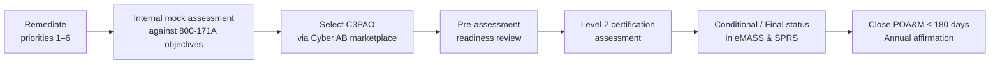

# SSP & C3PAO Readiness
**GlobalParts Manufacturing** · Document ID: GP-CMMC-RDY-001 · Version 1.0 · Classification: Internal (portfolio sample — contains no real CUI)

## Purpose
Brings the asset, data-flow, control, supplier and evidence work together into the two artefacts a C3PAO assesses first: the **System Security Plan (SSP)** and the **Plan of Action & Milestones (POA&M)**. It also sets out the coordination plan for the certification assessment.

## Readiness at a Glance

| Area | Status | Source |
|---|---|---|
| CUI boundary & asset categorisation | 🟢 Defined — 6 assets, 6 CUI flows | [Assets](Asset-Inventory.md) · [Data flows](CUI-Data-Flows.md) |
| Controls | 4 Effective · 7 Partial · 2 Ineffective · 1 Not Tested | [Controls](CMMC-Controls.md) |
| SSP | 🟡 v0.8 — 94 of 110 requirements documented | [EV-06](Evidence-Register.md#ev-06) |
| Supply chain | 🟡 1 high-risk supplier receiving CUI by email | [Supply chain](Supply-Chain-Vendor-Assessment.md) |
| Evidence | 🟡 6 of 14 controls evidenced | [Evidence](Evidence-Register.md) |
| **Overall** | 🟠 **Not ready for C3PAO assessment** — remediate the items below first | |

## SSP Structure (what the C3PAO expects)

| SSP section | Content | Status | Source in this repo |
|---|---|---|---|
| 1. System identification | System name, owner, CUI types, contracts | 🟢 | [README](README.md) |
| 2. System boundary | Network diagram, enclave, OT segment, cloud (GCC High) | 🟢 | [Assets](Asset-Inventory.md) |
| 3. Asset inventory & categorisation | CUI, Security Protection, Specialized assets | 🟢 | [Assets](Asset-Inventory.md) |
| 4. CUI data flows | Receipt, processing, sharing, retention | 🟢 | [Data flows](CUI-Data-Flows.md) |
| 5. External service providers | MSSP responsibilities; GCC High shared-responsibility matrix | 🔴 Missing | [V-03](Supply-Chain-Vendor-Assessment.md#v-03) |
| 6. Requirement implementation statements (110) | How each requirement is met, by whom, with what evidence | 🟡 94 / 110 | [Controls](CMMC-Controls.md) |
| 7. POA&M | Open items with owners and dates | 🟡 Draft | Below |

## Remediation Priorities (POA&M Candidates)

| # | Item | Control | Practice | Owner | Target | Why it matters |
|---|---|---|---|---|---|---|
| 1 | Fix CUI marking on printed drawings and derivative CAM files | [CC-04](CMMC-Controls.md#cc-04) | MP.L2-3.8.4 | Quality Director | 60 days | Core task in the brief; unmarked CUI also defeats DLP ([CC-03](CMMC-Controls.md#cc-03)) |
| 2 | Deploy FIPS 140-validated encryption on PLM server, ERP database and workstations | [CC-09](CMMC-Controls.md#cc-09) | SC.L2-3.13.11 | IT Security Lead | 90 days | A common assessment failure. Check POA&M eligibility under 32 CFR 170.21 before relying on it |
| 3 | Extend MFA to ERP/MES local admin logons | [CC-02](CMMC-Controls.md#cc-02) | IA.L2-3.5.3 | IT Manager | 45 days | High-value requirement; privileged access is the main gap |
| 4 | Run an IR tabletop including DIBNet reporting | [CC-10](CMMC-Controls.md#cc-10) | IR.L2-3.6.1 / 3.6.3 | IT Security Lead | 60 days | Capability exists but is untested |
| 5 | Stop CUI email to V-02 and complete supplier SPRS/CMMC verification | [CC-13](CMMC-Controls.md#cc-13) | DFARS 7012(m) | Supply Chain Security Manager | Immediate / 90 days | Live CUI exposure in the supply chain |
| 6 | Complete SSP: 16 remaining statements, ESP and GCC High responsibility matrix | [CC-14](CMMC-Controls.md#cc-14) | CA.L2-3.12.4 | Compliance Manager | 60 days | No SSP means no assessment |
| 7 | Onboard OT logs and connect ERP to IdP for 24-hour deprovisioning | [CC-06](CMMC-Controls.md#cc-06), [CC-12](CMMC-Controls.md#cc-12) | AU.L2-3.3.1, PS.L2-3.9.2 | IT Security Lead / HR Director | 90 days | Closes the remaining partial controls |
| 8 | Collect evidence for the 8 controls without artefacts | All | — | Control owners | 60 days | Assessors test every requirement with objective evidence |

## CMMC Level 2 Assessment Rules to Plan Around
- **Conditional vs. Final status:** under 32 CFR 170.21, a Conditional Level 2 status requires a minimum score of 88 (80% of 110) with only eligible requirements on the POA&M. All POA&M items must be closed within 180 days to reach Final status.
- **Not every requirement can be deferred:** certain higher-weighted requirements are not POA&M-eligible. Priorities 1–6 should be closed *before* the assessment rather than planned onto a POA&M.
- **Timing:** under the DFARS CMMC phase-in, Phase 2, which brings C3PAO Level 2 certification requirements into new contracts, begins 10 November 2026. GlobalParts' primes are already asking for certification plans.
- **Annual affirmation:** after certification, a senior official must affirm continued compliance in SPRS every year.

## C3PAO Coordination Plan

| Step | Activity | Owner | Target |
|---|---|---|---|
| 1 | Remediate priorities 1–6 and finalise SSP v1.0 | Compliance Manager | Q1 2027 |
| 2 | Internal mock assessment using NIST SP 800-171A objectives (examine, interview, test) | Compliance Manager + Internal Audit | Q1 2027 |
| 3 | Select an authorised C3PAO from the Cyber AB marketplace; confirm scope and assessor availability | Compliance Manager | Q1 2027 |
| 4 | Pre-assessment: share SSP, network diagrams, asset inventory and evidence index | Compliance Manager | Q2 2027 |
| 5 | Certification assessment (on-site at Detroit HQ and one Ohio plant; remote for GCC High) | All control owners | Q2 2027 |
| 6 | Close any POA&M items within 180 days; submit annual affirmation | Compliance Manager | Within 180 days |

## Key Takeaways
1. **Scope is well defined.** The GCC High enclave and isolated OT segment keep the assessment boundary tight.
2. **CUI handling is the biggest internal gap.** Marking failures and non-FIPS encryption must be fixed before assessment.
3. **The supply chain is the biggest external risk.** One sub-tier supplier is handling CUI insecurely.
4. **The SSP is close but not complete.** Finishing it and the ESP responsibility matrix is the critical path to the C3PAO.

---

← Previous: [Evidence](Evidence-Register.md) · [↑ Overview](README.md)
